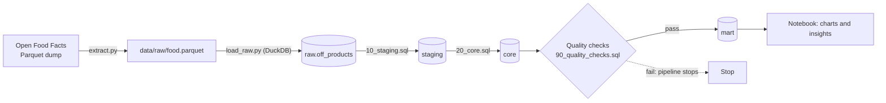
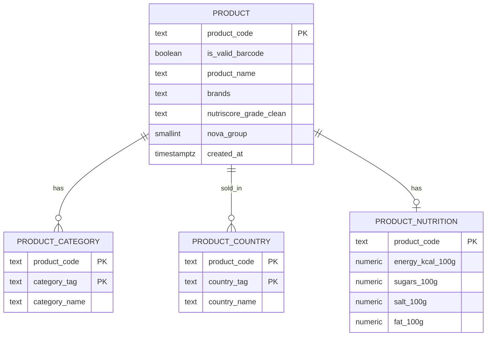
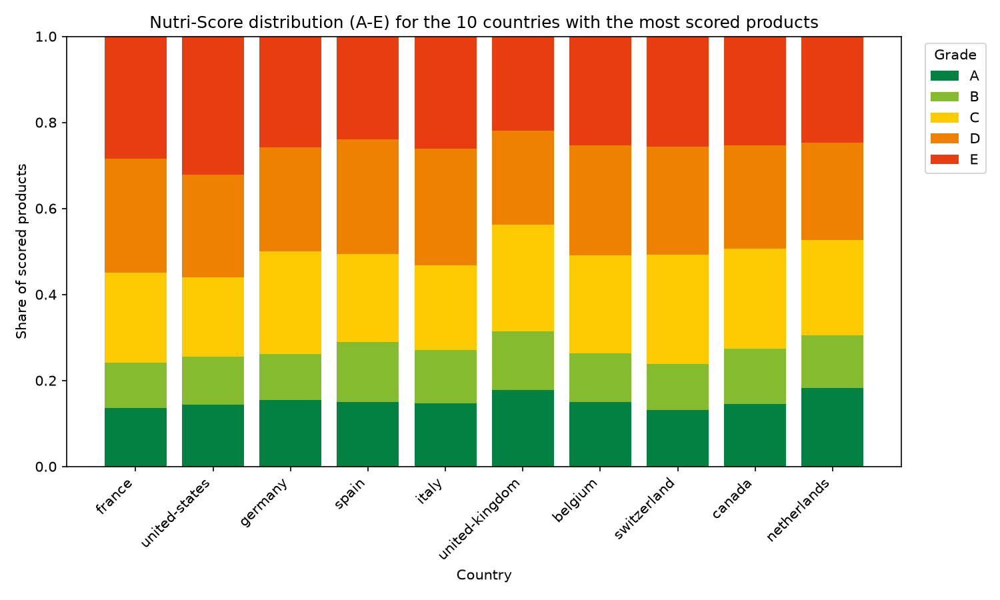
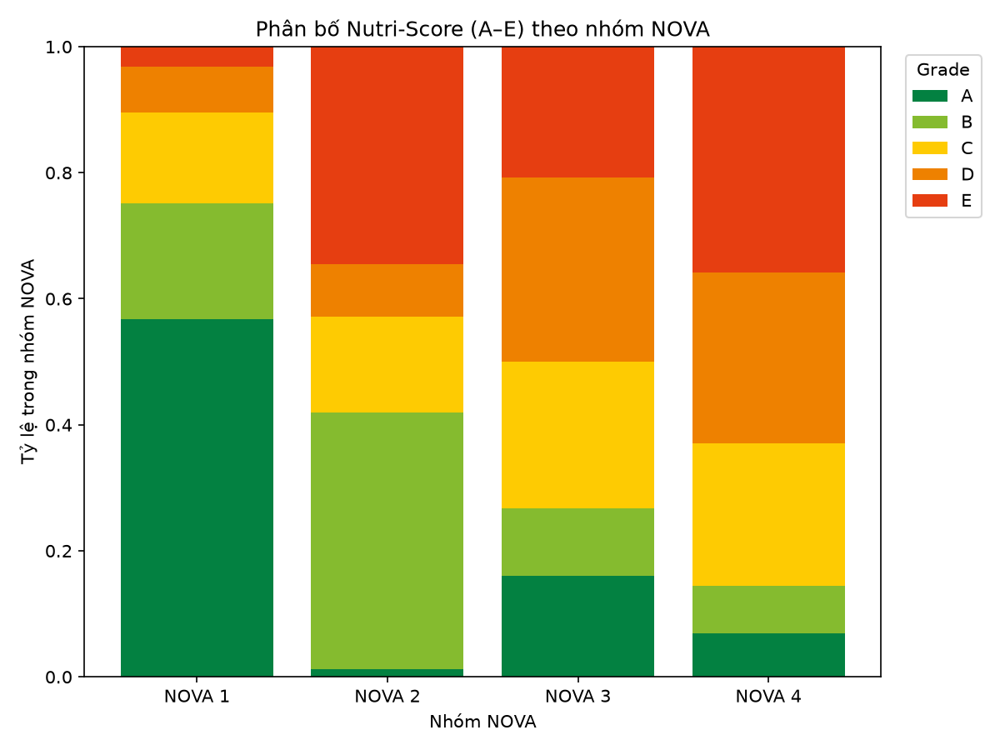
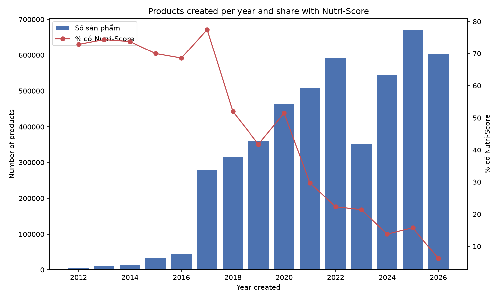

# Open Food Facts Analytics Pipeline

An end-to-end data engineering and analytics project: ingest the full [Open Food Facts](https://world.openfoodfacts.org/data) product dump (~4.8 million products), clean and model it in PostgreSQL, validate it with automated data quality checks, and analyze nutrition quality across countries, categories and processing levels.

Everything runs locally with one command: `python src/run_pipeline.py`.

## Highlights

- **Layered ELT design** (`raw -> staging -> core -> mart`) in PostgreSQL 16, run with Docker.
- **Fast bulk load** of a 111-column Parquet file with DuckDB (32 selected columns, nested fields kept as JSON in raw).
- **Idempotent pipeline**: every step rebuilds its own tables, so re-running gives the same result.
- **Data quality gate**: 14 automated checks run before the analytics layer is refreshed; the pipeline stops if any error-level check fails.
- **Real-world data issues handled**: duplicate and empty barcodes, NUL bytes, `Infinity`/`NaN` inside JSON, epoch timestamps, invalid Nutri-Score values.

## Key findings

> Numbers come from the data snapshot loaded in October 2026 and will change as Open Food Facts is updated.

- **Only about 29.6% of products have a real Nutri-Score (A-E).** Around 67% are `unknown`, so every comparison is made within the scored subset.
- **Across the 10 countries with the most scored products, 44-56% of scored products are graded D or E**, and only 24-31% are A or B. The UK has the lowest share of D/E (43.7%); the US has the highest (56.0%).
- **More processed food scores worse.** Among ~873k products with both NOVA and Nutri-Score, 75% of NOVA 1 (unprocessed) products are A/B, versus 14% of NOVA 4 (ultra-processed); D/E rises from 10% to 63%. This is a correlation, and both indicators are derived from product composition.
- **Data completeness is falling over time.** The share of newly created products that have a Nutri-Score dropped from ~73% (2012) to 6% (2026, partial year) while the number of new products per year grew from ~4k to 600k+.

## Architecture



| Layer | Purpose |
|---|---|
| `raw` | Near-original copy of the source (32 columns, nested fields as JSON, plus `_ingested_at` and `_source_file`). Never cleaned, so downstream logic can always be re-run. |
| `staging` | Cleaning and typing: drop empty/duplicate barcodes, flag invalid barcodes, clean Nutri-Score, convert timestamps, extract the main product name and 8 nutrients per 100g. |
| `core` | Dimensional-style model with primary keys, foreign keys and indexes. |
| `mart` | Pre-aggregated tables built for specific analytical questions. |

## Data model (core)



| Table | Grain | Rows (Oct 2026 snapshot) |
|---|---|---|
| `core.product` | 1 product | 4,788,236 |
| `core.product_category` | 1 product x 1 category | 10,373,140 |
| `core.product_country` | 1 product x 1 country | 4,965,230 |
| `core.product_nutrition` | 1 product | 3,693,167 |

Mart tables: `country_nutriscore`, `category_nutrition`, `nova_vs_nutriscore`, `brand_scores`, `country_completeness`, `products_by_year`.

## Tech stack

Python 3.11 · DuckDB · PostgreSQL 16 · Docker Compose · SQL · pandas · matplotlib · Jupyter

## Project structure

```
.
├── docker-compose.yml        # PostgreSQL 16
├── .env.example              # connection settings (copy to .env)
├── requirements.txt
├── src/
│   ├── config.py             # settings from .env
│   ├── extract.py            # download the Parquet dump
│   ├── load_raw.py           # Parquet -> raw.off_products (DuckDB)
│   ├── run_sql.py            # run .sql files in a transaction
│   ├── run_checks.py         # data quality checks runner
│   └── run_pipeline.py       # run everything in order
├── sql/
│   ├── 00_init_schemas.sql
│   ├── 10_staging.sql
│   ├── 20_core.sql
│   ├── 30_mart.sql
│   └── 90_quality_checks.sql
├── notebooks/01_analysis.ipynb
└── docs/                     # data notes, schema, charts
```

## Getting started

**Requirements:** Docker Desktop, Python 3.11+, and roughly 15 GB of free disk space (the Parquet file is several GB and the raw table is about 5.4 GB).

```bash
git clone https://github.com/QuangNghiaDA/off-food-analytics.git
cd off-food-analytics

cp .env.example .env            # Windows: Copy-Item .env.example .env
# edit .env and set POSTGRES_PASSWORD

docker compose up -d            # wait until the container is healthy

python -m venv .venv
source .venv/bin/activate       # Windows: .\.venv\Scripts\Activate.ps1
pip install -r requirements.txt

python src/run_pipeline.py      # full run: roughly 38m16s minutes depending on hardware
```

Useful options:

```bash
python src/run_pipeline.py --dry-run          # print the steps, run nothing
python src/run_pipeline.py --from core        # resume from a step
python src/run_pipeline.py --force-extract    # re-download the Parquet file
python src/run_pipeline.py --sample 100000    # quick test; replaces ALL data with a sample
```

Explore the results:

```bash
docker exec -it off_postgres psql -U off_user -d off_db \
  -c "SELECT country_name, n_scored, pct_a_b, pct_d_e FROM mart.country_nutriscore ORDER BY n_scored DESC LIMIT 10;"
```

Then open `notebooks/01_analysis.ipynb`.

## Data quality

`src/run_checks.py` runs 14 checks on the `core` layer. Error-level checks must return 0 violations or the pipeline stops before `mart` is rebuilt; warning-level checks are reported only.

| Level | Checks |
|---|---|
| Error (9) | empty or duplicate product code, orphan rows in category/country/nutrition, invalid Nutri-Score, invalid NOVA group, nutrients out of range, `en:world` left in countries |
| Warning (5) | saturated fat > fat (3,760 rows), sugars > carbohydrates (4,081 rows), created after modified, modified in the future, invalid barcode length (70,905 rows) |

Warning rows are kept and flagged rather than silently changed.

## Analysis

The notebook answers six questions from the `mart` layer:

1. How are Nutri-Score grades distributed across countries?
2. Which food categories contain the most sugar?
3. How do NOVA processing levels relate to Nutri-Score?
4. Which brands score best and worst?
5. How complete is the data per country?
6. How has the database grown and changed in quality over time?







## Limitations

- The data is crowd-sourced, skewed toward France and the US, and Nutri-Score is missing for about 70% of products.
- `categories_tags` is a hierarchy: one product belongs to several (on average about 5) overlapping categories, so categories must not be summed.
- A product can be sold in several countries and counts once per country.
- Brand analysis uses only the first brand listed in the `brands` field, and brand ranking mostly reflects the product category a brand sells.
- A few source strings contain NUL characters that PostgreSQL cannot store; they are removed during loading.
- Findings show correlations in a convenience dataset, not representative market statistics.

## Roadmap

- Incremental loads using Open Food Facts delta exports
- Scheduling and orchestration with Airflow
- Transformations and tests with dbt
- BI dashboard (Power BI)

## Data source and license

This project contains information from [Open Food Facts](https://world.openfoodfacts.org/data), made available under the [Open Database License (ODbL)](https://opendatacommons.org/licenses/odbl/1-0/). The data itself is not included in this repository; it is downloaded by `src/extract.py`.

## Author

Tran Quang Nghia · [LinkedIn](https://www.linkedin.com/in/tqnghia610/)
